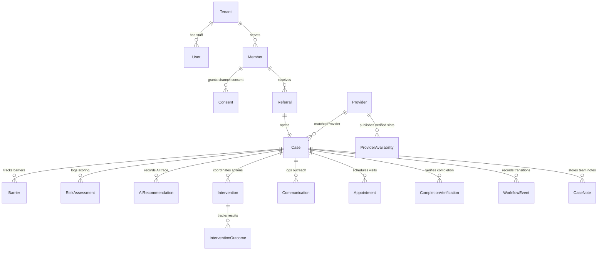

# CareLoop Data Model (`DATA_MODEL.md`)

CareLoop uses PostgreSQL 15+ managed by Prisma (`prisma/schema.prisma`, **10 applied migrations** in `prisma/migrations/`). Every clinical-operational, AI, communication, and audit entity includes a foreign key `tenantId` referencing `Tenant(id)` with cascade safety and tenant-prefixed composite indexes.

---

## 1. Core Entity Relationships

---

## 2. Key Models & Governance Fields

- **Multi-Tenancy & Identity:**
  - `Tenant` (`slug`, `planType`, `settings` JSON storing thresholds, session TTL hours, and retention policies)
  - `Role`, `User` (`tenantId + email` unique, salted scrypt `passwordHash`, `UserRole`), `UserSession` (`revokedAt`, `expiresAt`, `userAgent` for server-side session revocation)
- **Intake & Navigation Entities:**
  - `Member` (`tenantId + externalMemberId` unique, `preferredLanguage`, `geography`, `urbanicity`, `coverageType`, `transportationAccess`, `digitalAccessLevel`, `raceEthnicityCohort`, `ageGroupCohort`)
  - `Consent` (`channel`, `purpose`, `granted`, timestamped source provenance)
  - `IngestionBatch` (`fileName`, `status`, `totalRows`, `successRows`, `errorRows`, `errorsJson`)
  - `Referral` (`tenantId + externalReferralId` unique, `specialty`, `behavioralHealthNeed`, `urgency`, `networkRequired`, `eligibilityVerified`, `ReferralStatus`)
  - `Provider` & `ProviderAvailability` (`AvailabilitySource`: `VERIFIED_AVAILABILITY` | `DIRECTORY_INFORMATION` | `NOT_AVAILABLE`, explicit `availabilityLastVerifiedAt` for staleness alerts)
- **Execution & Traceability Entities:**
  - `Case` (`CaseStatus`, `goal`, `priorityScore`, `riskLevel`, `primaryBarrierCategory`, `primaryBarrierCode`, `humanReviewRequired`, `firstCompletedVisitAt`, `closedAt`, `closureReason`, `slaDueAt`)
  - `Barrier` (`epistemicStatus`: `FACT` | `INFERENCE` | `UNKNOWN`, `evidenceSignals`, `confirmedByHuman`, `confirmedById`)
  - `RiskAssessment` (`score`, `riskLevel`, `confidence`, `evidenceSignals`, `providerName`, `modelVersion`, `humanEscalationSuggested`)
  - `AIRecommendation` (`operation`, `status`, `providerName`, `modelVersion`, `promptVersion`, `inputContext`, `outputPayload`, `facts`, `inferences`, `recommendations`, `confidence`, `uncertainty`, `resultingAction`, `humanReviewerId`)
  - `Intervention` & `InterventionOutcome` (`executionMode`: `AUTOMATED` | `HUMAN_ASSISTED` | `HUMAN_ONLY`, `isHighRisk`, `automationEligible`, `barriersResolved`, `followUpRequired`)
  - `Communication` (`channel`, `messageType`, `readingLevel`, `templateKey`, `draftedByAi`, `internalAiLabel`, `humanApprovedById`, `deliveryStatus`)
  - `Appointment` (`AppointmentStatus`, `availabilitySourceAtBooking`, `confirmedAt`, `completedAt`, `cancellationReason`)
  - `CompletionVerification` (`VerificationSignalType`, `VerificationStatus`, `confidence`, `sourceSystem`, `evidenceNote`, `verifiedById`, `verifiedAt`)
- **Compliance & Analytics:**
  - `AuditEvent` (`tenantId`, `actorId`, `actorEmail`, `actorRole`, `action`, `entityType`, `entityId`, `source`, `previousState`, `newState`, `summary`, `metadata`, `correlationId`, `createdAt`)
  - `WorkflowEvent` (`fromStatus`, `toStatus`, `eventType`, `actorId`, `actorRole`, `reason`)
  - `EquityMetric` (`cohortDimension`, `cohortValue`, `totalReferrals`, `completedVisits`, `completionRatePct`, `avgTimeToCareDays`, `disparityGapPctPoints`)

---

## 3. Database Indexes & Operational Notes

- Composite tenant indexes protect dashboard, worklist, and case-detail lookups:
  - `Case`: `@@index([tenantId, status, priorityScore])`, `@@index([tenantId, riskLevel])`
  - `Appointment`: `@@index([tenantId, status, scheduledStartAt])`, `@@index([tenantId, caseId])`
  - `ProviderAvailability`: `@@index([tenantId, providerId, status, slotStartAt])`
  - `AuditEvent`: `@@index([tenantId, entityType, entityId])`, `@@index([tenantId, createdAt])`
- **Production Note:** Refer to [`DEPLOYMENT.md`](DEPLOYMENT.md) and [`OPERATIONS.md`](OPERATIONS.md) for scheduled retention purge jobs, database connection pooling (`PgBouncer`), and append-only audit role controls.
