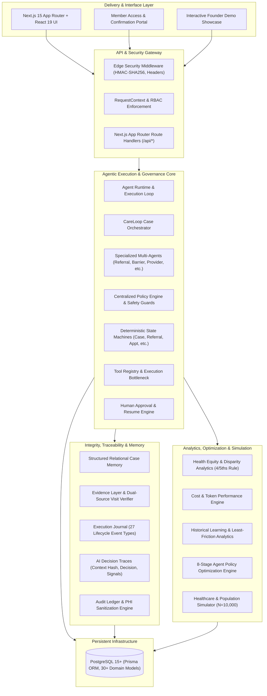

# CareLoop System Architecture & Technical Specifications

**Document Version:** 3.1.0  
**Status:** PRODUCTION ARCHITECTURE SPECIFICATION  
**Scope:** Care Navigation from Referral Ingestion to First Verified Behavioral-Health Visit  

---

## 1. System Overview & Core Principles

CareLoop is a multi-tenant behavioral-health care coordination platform engineered to eliminate scheduling friction, resolve social-logistical barriers (e.g., transportation, language, provider shortages), and achieve equitable access to care.

### Critical Architectural Rule: AI Autonomy vs. System Autonomy

> **Never confuse AI autonomy with system autonomy.**
>
> CareLoop is designed to be **highly autonomous in coordinating routine execution** while remaining **tightly governed**.

```
                 CARELOOP
                     |
             CASE ORCHESTRATOR
                     |
       ┌─────────────┼─────────────┐
       |             |             |
   STATE MACHINE   POLICY        MEMORY
       |           ENGINE           |
       └─────────────┼─────────────┘
                     |
                TOOL REGISTRY
                     |
        ┌────────────┼────────────┐
        |            |            |
     PROVIDER    SCHEDULING   COMMUNICATION
        |            |            |
        └────────────┼────────────┘
                     |
              HUMAN APPROVAL
                     |
              EXECUTION JOURNAL
                     |
                  EVIDENCE
                     |
             OUTCOME VERIFICATION
                     |
                  LEARNING
```

### The 7 Authority & Separation Principles

- **The agent is the execution intelligence.**  
  Observes case state, reasons over clinical context, hypothesizes barriers, and proposes multi-step plans. It has zero direct mutation authority.
- **The state machine is the workflow authority.**  
  Governs lifecycle state transitions deterministically. No status jump occurs unless pre-conditions, required fields, and valid transition matrices are satisfied.
- **The policy engine is the safety authority.**  
  Enforces hard rules on clinical safety, consent, frequency limits, PHI protection, and supervisor review requirements before any action executes.
- **The tool registry is the action boundary.**  
  Defines the strictly typed API surface through which the agent interacts with external systems. All inputs and outputs conform to validated Zod schemas.
- **The human is the judgment and exception layer.**  
  Maintains human-in-the-loop oversight. Clinical supervisors approve privileged actions, resolve escalations, and handle clinical exceptions.
- **The evidence layer is the truth layer.**  
  Cryptographically anchors every finding and event to tamper-evident records (SHA-256 payload hashes, EHR encounter claims, member attestations).
- **The learning layer is the improvement and defensibility layer.**  
  Aggregates longitudinal outcomes, evaluates interventions counterfactually, and proposes policy optimizations through rigorous offline simulation and human review.

> **"That is CareLoop."**

### Core Architectural Axioms
1. **System Authority Boundary:**
   > *"The agent decides what should happen next. The system decides what is allowed to happen."*  
   AI models, planners, and agents never possess unrestricted mutation authority or direct database access. Every action is gated by deterministic policy checks, state machine validation, and human review requirements.
2. **Anti-Autonomous Policy Mutation Invariant:**
   > *"Never allow the agent to rewrite its own production policy autonomously."*  
   All learning outputs and policy optimizations are strictly advisory proposals (`ADVISORY_PROPOSAL_ONLY`). Candidate changes must traverse an 8-stage verification pipeline and require human clinical supervisor sign-off.
3. **Epistemic Truth Separation:**
   Operational truth is strictly demarcated:
   - **FACT:** Human-confirmed data or verified cryptographic signals.
   - **INFERENCE:** AI-derived hypothesis requiring corroboration or human review.
   - **RECOMMENDATION:** Proposed next action awaiting policy approval or execution.
4. **Structured Relational Memory (Zero Raw Chat Transcripts):**
   CareLoop deliberately rejects freeform chat transcripts or raw LLM conversation histories in operational storage. Case memory is strictly structured and relational.

---

## 2. High-Level Architecture Topology



---

## 3. Comprehensive Component Architecture Review

### Component 1: Agent Layer
- **Status:** **IMPLEMENTED**
- **Modules:**
  - `src/ai/orchestrator.ts` (`CareLoopCaseOrchestrator`)
  - `src/agent/orchestrator-agent.ts` (`CareLoopOrchestratorAgent`)
  - `src/agent/barrier-agent.ts` (`BarrierIntelligenceAgent`)
  - `src/agent/provider-matching-agent.ts` (`ProviderMatchingAgent`)
  - `src/agent/multi_agent/` (`agent-registry.ts`, `contracts.ts`, `specialized-agents.ts`, `shared-invariants.ts`)
  - `src/agent_runtime/` (`runtime.ts`, `execution-loop.ts`, `components.ts`)
  - `src/lib/events/agent-reactions.ts` (Event-driven agent handlers)
- **Key Capabilities:**
  - Pluggable deterministic or external LLM planner (`AIProvider`).
  - Multi-agent readiness with specialized agents: `ReferralAgent`, `BarrierAgent`, `ProviderAgent`, `SchedulingAgent`, `EngagementAgent`, `VerificationAgent`, `EquityAgent`.
  - **Shared Invariants:** All agents operate under shared state, shared policy, shared audit, shared evidence, and shared immutable case goals. No agent may independently redefine case goals.
  - Event-driven reactions reacting idempotently across 12 domain event types.

### Component 2: State Machine Layer
- **Status:** **IMPLEMENTED**
- **Modules:**
  - `src/domain/cases/state-machine.ts`
  - `src/domain/referrals/state-machine.ts`
  - `src/domain/appointments/state-machine.ts`
  - `src/domain/interventions/state-machine.ts`
  - `src/domain/communications/state-machine.ts`
  - `src/workflow/index.ts` (`CaseWorkflowEngine`)
- **Key Capabilities:**
  - **Case State Machine:** 10 sequential operational states (`NEW`, `TRIAGED`, `BARRIER_IDENTIFIED`, `INTERVENTION_RECOMMENDED`, `INTERVENTION_IN_PROGRESS`, `APPOINTMENT_SCHEDULED`, `APPOINTMENT_CONFIRMED`, `APPOINTMENT_COMPLETED`, `VERIFIED`, `CLOSED`) and 4 exception states (`ESCALATED`, `BLOCKED`, `REQUIRES_HUMAN_REVIEW`, `LOST_TO_FOLLOW_UP`).
  - Strict mathematical transition matrix; illegal status jumps are rejected with `InvalidStateTransitionError` (`409`).

### Component 3: Policy Engine
- **Status:** **IMPLEMENTED**
- **Modules:**
  - `src/policy/index.ts`, `src/policy/contracts.ts` (`CareLoopPolicyEvaluator`, `ENTERPRISE_POLICY_RULES`)
  - `src/ai/policy-engine.ts`, `src/ai/policy-guard.ts`
  - `src/domain/policy-optimization/` (`contracts.ts`, `invariants.ts`, `evaluation-harness.ts`, `simulation-engine.ts`, `safety-evaluator.ts`, `rollout-controller.ts`, `telemetry-monitor.ts`)
- **Key Capabilities:**
  - Central policy evaluator returning `ALLOW`, `DENY`, `REQUIRE_APPROVAL`, or `REQUIRE_HUMAN`.
  - Hard guards: PHI minimization, BAA boundary, member consent enforcement, clinical advice prohibition (`assertNoClinicalAdvice`), tenant autonomous execution toggles.
  - Policy Optimization Pipeline: Candidate policy modifications must traverse 8 sequential stages (`proposal -> offline evaluation -> simulation -> safety evaluation -> human review -> versioning -> controlled deployment -> monitoring`).

### Component 4: Tool Registry & Execution Layer
- **Status:** **IMPLEMENTED**
- **Modules:**
  - `src/ai/tool-registry.ts` (`CARE_LOOP_TOOL_REGISTRY`, 13 canonical orchestrator tools)
  - `src/tools/registry.ts`, `src/tools/initial-tools.ts`, `src/tools/index.ts` (`CareLoopToolRegistry`, 18 atomic tools)
  - `src/services/tool-executor.ts` (`executeCareLoopTool`)
- **Key Capabilities:**
  - Formal schemas for inputs and outputs via Zod.
  - Risk levels: `LOW`, `MEDIUM`, `HIGH`.
  - Idempotency strategies: `SAFE_READ`, `IDEMPOTENCY_KEY`, `STATE_PRECONDITION`, `UNIQUE_CONSTRAINT`.
  - Central execution funnel enforcing: RBAC check $\to$ Case state validation $\to$ Policy guard $\to$ Consent verification $\to$ Tool execution $\to$ Output validation $\to$ Evidence capture $\to$ Audit log $\to$ Execution journal $\to$ Observability span $\to$ State transition.

### Component 5: Approval Engine
- **Status:** **IMPLEMENTED**
- **Modules:**
  - `src/services/approval-service.ts`
  - `prisma.approvalRequest`
  - `/api/approvals`, `/api/approvals/[approvalId]/decide`, `/api/approvals/[approvalId]/resume`
- **Key Capabilities:**
  - Persistent approval requests with pending state, TTL expiration (24h), and supervisor review.
  - Seamless resume capability: once approved, the orchestrator immediately resumes execution from the exact paused step without state loss.
  - Rejects automated agent self-approval (`AutonomousPolicyRewriteProhibitedError`).

### Component 6: Case Memory Layer
- **Status:** **IMPLEMENTED**
- **Modules:**
  - `src/domain/cases/case-memory.ts` (`StructuredCaseMemory`, `buildStructuredCaseMemory`)
- **Key Capabilities:**
  - Canonical policy: `STRUCTURED_RELATIONAL_ONLY_NO_RAW_LLM_TRANSCRIPTS`.
  - Explicit rejection of raw chat logs, system prompts, or hallucinated LLM transcripts.
  - Structured aggregation:
    1. Member facts (preferences, language, geographic & access constraints, consent records)
    2. Referral facts (need, specialty, urgency, eligibility)
    3. Epistemic barrier observations (categorized as `FACT` vs `INFERENCE`)
    4. Action & tool call logs
    5. Human interactions & supervisor approvals
    6. Outcome verification signals

### Component 7: Evidence Layer
- **Status:** **IMPLEMENTED**
- **Modules:**
  - `src/evidence/contracts.ts`, `src/evidence/index.ts` (`EvidenceStore`, `InMemoryEvidenceStore`, `PrismaEvidenceStore`)
  - `src/domain/completion/verifier.ts` (`evaluateVerificationSignal`)
  - `prisma.evidence`, `prisma.completionVerification`
- **Key Capabilities:**
  - SHA-256 payload hashing (`hashEvidencePayload`) guaranteeing evidence immutability.
  - Integrity check `verifyIntegrity(evidence, payload)`.
  - Two-sided completion verification: requires at least two independent concordant signals (e.g., clinic confirmation + member self-report, or EHR encounter + claims 837P) before a visit is verified.

### Component 8: Execution Journal
- **Status:** **IMPLEMENTED**
- **Modules:**
  - `src/services/execution-journal-service.ts`
  - `src/services/decision-trace-service.ts`
  - `prisma.executionJournalEvent`, `prisma.aIDecisionTrace`
- **Key Capabilities:**
  - Append-only event stream tracking 27 lifecycle event types.
  - Full trace linkage: `caseId`, `correlationId`, `actorType`, `actorId`, `eventType`, `inputReference`, `outputReference`, `policyDecision`, `evidence`.
  - AI Decision Traces capture model, prompt version, input context hash, decision, confidence, and policy result without leaking raw chain-of-thought tokens.

### Component 9: Audit Layer
- **Status:** **IMPLEMENTED**
- **Modules:**
  - `src/services/audit-service.ts`
  - `src/repositories/governance-repository.ts`
  - `src/lib/logger.ts` (`redactSensitiveFields`, `sanitizeAuditText`)
  - `prisma.auditEvent`, `prisma.ingestionBatch`
- **Key Capabilities:**
  - Multi-tenant isolated, append-only audit trail.
  - Sensitive field redaction (passwords, auth tokens, SSNs, MRNs, DOBs).
  - Full audit coverage for logins, state changes, tool executions, approval decisions, policy proposals, and manual/automated rollbacks.

### Component 10: Analytics Layer
- **Status:** **IMPLEMENTED**
- **Modules:**
  - `src/domain/equity/analytics.ts`, `src/services/analytics-service.ts`
  - `src/services/cost-performance-service.ts`, `src/lib/optimization/cost-performance-engine.ts`
  - `src/domain/pilot/measurement-engine.ts`, `src/domain/pilot/experimentation-engine.ts`
  - `src/domain/learning/learning-system.ts`
- **Key Capabilities:**
  - **Health Equity Analytics:** Disparity gap analysis across race/ethnicity, language, urbanicity, age cohorts, and SVI quartiles; enforces small-sample suppression ($N < 10$).
  - **Executive KPIs:** Referral-to-care velocity, visit completion rate, barrier resolution rate, no-show rate.
  - **Cost & Performance:** Operational unit costs, token usage, cache hit rates, model routing savings.
  - **Pilot Trial Engine:** 4-arm randomized study metrics (`INTERVENTION_A` vs `INTERVENTION_B` vs `HUMAN_ASSISTED` vs `USUAL_CARE`), hazard ratios, odds ratios, and p-values.
  - **Least-Friction Historical Query:** Answers which intervention achieves optimal visit completion with minimal delays, human toil, and clinic no-shows.

### Component 11: Evaluation Layer
- **Status:** **IMPLEMENTED**
- **Modules:**
  - `src/ai/evaluation.ts`, `src/services/evaluation-service.ts`
  - `src/evaluation/agent-eval-framework.ts`
  - `src/domain/policy-optimization/evaluation-harness.ts`
  - `src/domain/risk/model-evaluation.ts`
- **Key Capabilities:**
  - 10-scenario golden benchmark evaluation suite.
  - 15-scenario trace evaluator covering edge cases (missing data, provider shortages, ambiguous barriers, policy denials, duplicate events).
  - Offline candidate policy evaluation harness with strict 100% critical safety pass requirement.
  - Non-discriminatory risk model evaluation.

### Component 12: Simulation Layer
- **Status:** **IMPLEMENTED**
- **Modules:**
  - `src/simulation/demo-environment.ts`
  - `src/simulation/healthcare-simulator.ts`
  - `src/simulation/founder-demo-runner.ts`, `founder-demo.ts`
  - `src/domain/pilot/pilot-simulator.ts`, `experiment-simulator.ts`
  - `src/domain/policy-optimization/simulation-engine.ts`
- **Key Capabilities:**
  - **Demo Environment Showcase:** Generates 10,000 synthetic members with realistic behavioral-health referrals, barriers, provider networks, appointments, and equity cohorts.
  - **Founder Demo Mode:** 7-act scripted founder journey demonstrating population entry, AI prioritization, agent execution, human approval gate, verified completion, equity disparities, and historical learning.
  - **Pilot Trial Simulator:** Simulates 10,000–50,000 member 3–6 month randomized multi-arm pilot trials.
  - **Policy Stress Simulator:** Simulates operational queues, provider shortage bottlenecks, and deadlock detection for candidate policies.

---

## 4. End-to-End Execution Flow

```text
[Referral Ingestion: CSV/FHIR]
       │
       ▼
[Validation, Normalization & Deduplication]
       │
       ▼
[Case Creation (NEW)] ───► [Risk & Barrier Assessment] ───► [Case (BARRIER_IDENTIFIED)]
                                                                   │
       ┌───────────────────────────────────────────────────────────┘
       ▼
[Intervention Recommendation (INTERVENTION_RECOMMENDED)]
       │
       ├─► High Risk or Policy Requirement? ──► [ApprovalRequest Created] ──► [Human Supervisor Review]
       │                                                                            │
       │                                                                      (APPROVED)
       ▼                                                                            │
[Intervention In Progress (INTERVENTION_IN_PROGRESS)] ◄─────────────────────────────┘
       │
       ├─► Provider Search & Verified Slot Match (search_providers)
       ├─► Culturally Concordant Outreach (send_member_communication)
       ├─► Assisted Scheduling (schedule_appointment) ──► [Case (APPOINTMENT_SCHEDULED)]
       ├─► Multi-Stage Reminders (send_reminder)
       │
       ▼
[Clinic Encounter (APPOINTMENT_COMPLETED)]
       │
       ▼
[Dual-Source Verification (verify_completion)] ──► [Case (VERIFIED)]
       │
       ▼
[Execution Journal & Structured Case Memory Updated]
       │
       ▼
[Historical Learning Snapshot Captured (10 Dimensions)]
       │
       ▼
[Analytics & Equity Disparity Dashboards Reconciled]
```

---

## 5. Security, PHI & Privacy Safeguards

1. **PHI Minimization:** Raw unminimized PHI is stripped prior to agent processing. Log files scrub protected identifiers via `redactSensitiveFields`.
2. **BAA Ingress/Egress Guard:** External LLM calls are blocked unless `AI_BAA_EXECUTED=true` is set. If not executed, the system automatically falls back to deterministic rule providers.
3. **Session & RBAC Security:** 12-hour signed HMAC-SHA256 session cookies; per-route RBAC gates check permissions (`cases.read`, `cases.write`, `cases.admin`, `approvals.decide`, `completion.verify`).
4. **Tenant Isolation:** Every Prisma query and mutation is explicitly scoped to `tenantId`. Cross-tenant lookups return `404 Not Found`.

---

## 6. Architecture Verification Matrix

| Component | Status | Unit Tests | Integration / E2E Tests | Primary Source Path |
| :--- | :---: | :---: | :---: | :--- |
| **Agent** | **IMPLEMENTED** | `multi-agent-readiness.test.ts`, `barrier-agent.test.ts` | `agent-runtime.test.ts`, `agentic-execution-loop.test.ts` | `src/agent/` & `src/agent_runtime/` |
| **State Machine** | **IMPLEMENTED** | `state-machine.test.ts` | `referral-ingestion-pipeline.test.ts` | `src/domain/cases/state-machine.ts` |
| **Policy Engine** | **IMPLEMENTED** | `policy-engine.test.ts`, `policy-optimization.test.ts` | `policy-optimization.test.ts` | `src/policy/` & `src/ai/policy-engine.ts` |
| **Tool Registry** | **IMPLEMENTED** | `tool-registry.test.ts` | `initial-tools.test.ts`, `tool-executor.ts` | `src/tools/` & `src/ai/tool-registry.ts` |
| **Approval Engine** | **IMPLEMENTED** | `human-approval.test.ts` | `approval-flow.test.ts`, `full-system-qa.test.ts` | `src/services/approval-service.ts` |
| **Case Memory** | **IMPLEMENTED** | `case-memory.test.ts` | `full-system-qa.test.ts` | `src/domain/cases/case-memory.ts` |
| **Evidence Layer** | **IMPLEMENTED** | `completion-verification.test.ts` | `evidence-and-soft-delete.test.ts` | `src/evidence/` |
| **Execution Journal** | **IMPLEMENTED** | `audit-and-traceability.test.ts` | `observability.test.ts` | `src/services/execution-journal-service.ts` |
| **Audit Layer** | **IMPLEMENTED** | `audit-and-traceability.test.ts` | `security-and-safety.test.ts` | `src/services/audit-service.ts` |
| **Analytics** | **IMPLEMENTED** | `health-equity-analytics.test.ts`, `cost-performance-optimization.test.ts` | `health-equity.test.ts`, `cost-performance-optimization.test.ts` | `src/services/analytics-service.ts` |
| **Evaluation** | **IMPLEMENTED** | `agent-evaluation.test.ts`, `agent-evaluation-framework.test.ts` | `evaluation-service.test.ts` | `src/ai/evaluation.ts` & `src/evaluation/` |
| **Simulation** | **IMPLEMENTED** | `demo-environment-showcase.test.ts`, `founder-demo.test.ts` | `demo-environment.test.ts`, `founder-demo.test.ts` | `src/simulation/` |
