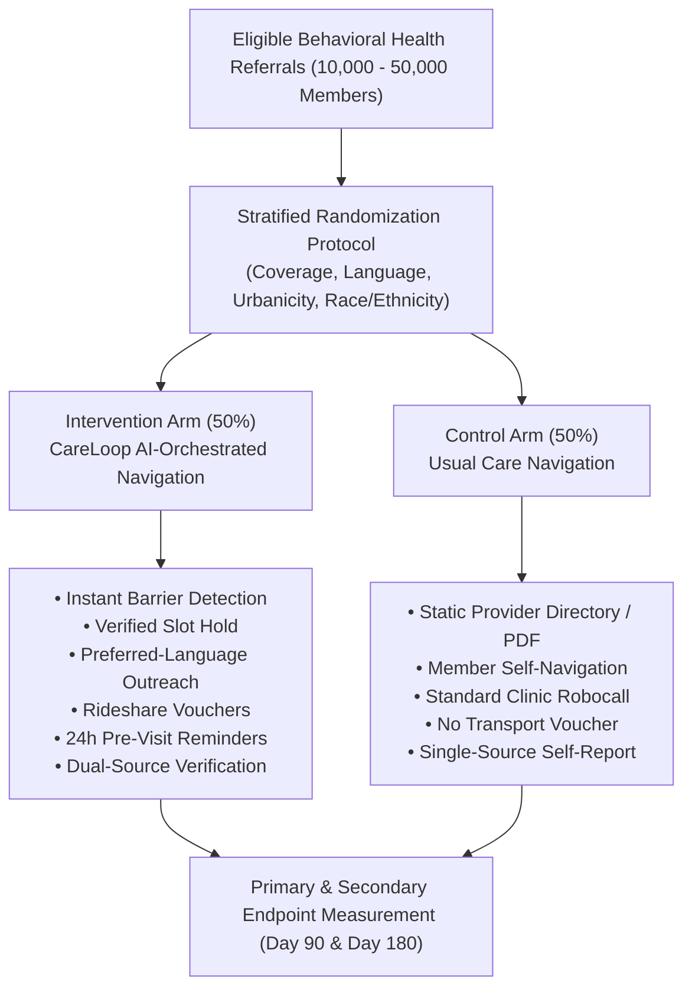
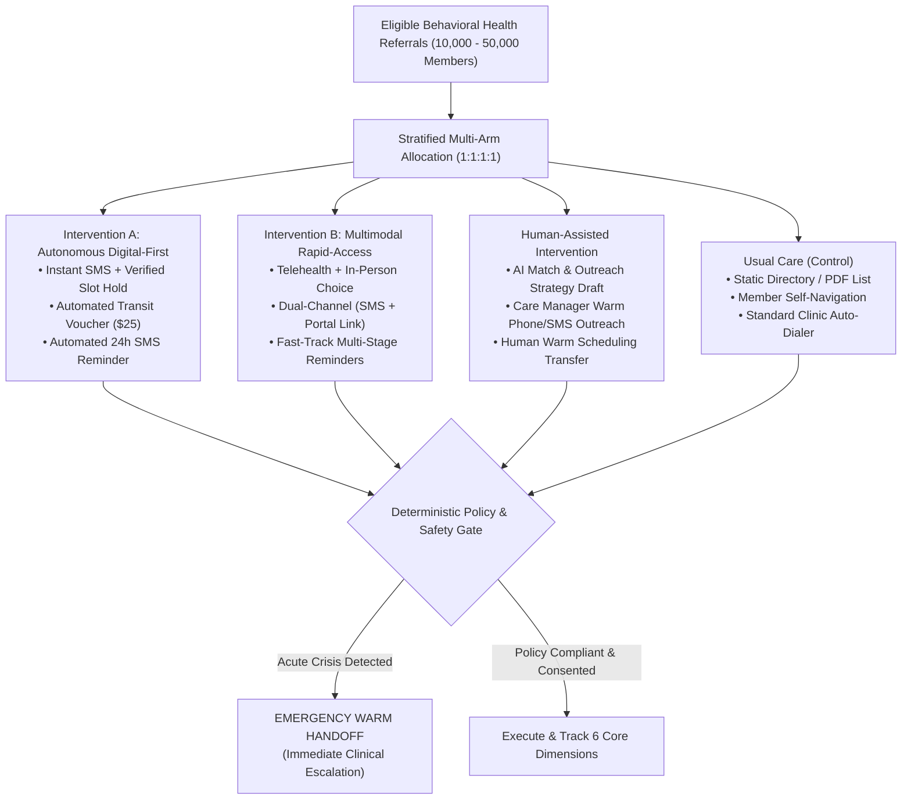

# CareLoop Pilot Measurement Framework
## Validating Equitable Behavioral-Health Access at Scale

**Document Version:** 1.0.0  
**Target Horizon:** 3–6 Month Pilot  
**Target Cohort:** 10,000–50,000 Members  
**Primary Endpoint:** Referral $\rightarrow$ First Completed Behavioral-Health Visit  
**Study Design:** Pragmatic Two-Arm Randomized Controlled Trial (Intervention vs. Usual Care/Control)  

---

## 1. Executive Summary & Objective

The immediate objective of the CareLoop pilot is **not** to deploy every possible enterprise feature of the future roadmap. The objective is singular and focused:

> **Validate one high-impact healthcare execution problem:**  
> Prove that autonomous, policy-guarded care orchestration dramatically increases verified first-visit completion rates and closes persistent racial, linguistic, and socio-economic access disparities for behavioral-health referrals.

Across commercial and Medicaid populations, **less than 22% of outpatient behavioral-health referrals ever result in a completed visit**. The remaining 78% drop out due to phantom provider directories, scheduling delays, language discordance, and logistical/transportation barriers.

This framework defines the methodology, endpoints, statistical power, and economic measurement for a **3–6 month pilot involving 10,000 to 50,000 members**.

---

## 2. Study Design & Population



### 2.1 Target Population
- **Inclusion Criteria:**
  - Active plan members with an open outpatient behavioral-health referral (psychiatry, psychotherapy, addiction medicine, child/adolescent mental health).
  - Age $\ge 18$ (or pediatric cohorts with guardian consent).
  - Enrolled in Medicaid Managed Care, Medicare Advantage, or Commercial health plans.
- **Exclusion Criteria:**
  - Members in acute psychiatric emergency requiring immediate crisis stabilization / 911 / 988.
  - Active inpatient hospitalization at time of referral.

### 2.2 Study Arms
1. **Intervention Arm (`INTERVENTION`)**:
   - Automated barrier identification within minutes of referral ingestion.
   - Deterministic provider matching filtering for verified availability, network tier, and language concordance.
   - Culturally empathetic member outreach via preferred channel (SMS/Portal/Phone) in primary language (English, Spanish, etc.).
   - Targeted barrier resolution (e.g., automated rideshare voucher for transit deficits).
   - Proactive 24-hour pre-visit check-in reminders.
   - Multi-source completion verification (EHR encounter attestation + adjudicated 837P claim).
2. **Control Arm (`USUAL_CARE_CONTROL`)**:
   - Standard payer/provider navigation: Member receives a static provider directory list or generic portal link.
   - Member is responsible for cold-calling clinics to locate openings.
   - Standard clinic auto-dialer or no proactive reminder.
   - No transportation assistance.
   - Completion tracked via standard uncorroborated administrative claims lag (60–90 days).

### 2.3 Stratified Randomization Protocol
To guarantee covariate balance and prevent demographic bias between study arms, assignment is performed using deterministic stratified pseudo-random hashing:
$$\text{Assignment} = \text{SHA-256}(\text{Seed} \parallel \text{StrataKey} \parallel \text{MemberID})$$
Strata include:
- **Coverage Type:** Medicaid Managed Care, Commercial, Medicare Dual.
- **Language:** English, Spanish, Other.
- **Urbanicity:** Urban, Suburban, Rural.
- **Race/Ethnicity:** Hispanic/Latino, Black/African American, White, Asian/Pacific Islander, Other.

---

## 3. Endpoints & Measurement Specifications

### 3.1 Primary Endpoint: Referral $\rightarrow$ First Completed Visit

| Metric Attribute | Specification |
| :--- | :--- |
| **Formal Definition** | Proportion of eligible referrals that result in an attended, clinically verified first behavioral-health outpatient visit within the 90-day tracking window. |
| **Numerator** | Cases with verified visit attendance confirmed by clinic EHR attestation or adjudicated healthcare claim (`firstCompletedVisitAt != null`). |
| **Denominator** | All eligible referrals assigned to the arm. |
| **Null Hypothesis ($H_0$)** | $p_{\text{intervention}} = p_{\text{control}}$ |
| **Alternative Hypothesis ($H_1$)** | $p_{\text{intervention}} > p_{\text{control}}$ ($p < 0.001$, minimum $+25\%$ points absolute lift). |
| **Statistical Test** | Two-proportion $z$-test and Fisher's exact test with two-sided 95% confidence intervals. |
| **Time-to-Care Velocity** | Median days elapsed from referral date to first completed visit date. |

---

### 3.2 Secondary Metrics

#### 1. Time to Appointment (Days)
- **Definition:** Median days from referral generation date to the scheduled appointment date.
- **Expected Impact:** Reduction from usual care median ($36 - 44$ days) down to CareLoop median ($8 - 14$ days).

#### 2. No-Show Rate (%)
- **Definition:** $\frac{\text{No-Show Appointments}}{\text{Total Scheduled Appointments}} \times 100\%$
- **Expected Impact:** Relative reduction of $> 60\%$ (from usual care $32 - 42\%$ down to CareLoop $9 - 13\%$) driven by transportation vouchers and automated pre-visit check-ins.

#### 3. Member Engagement Rate (%)
- **Definition:** $\frac{\text{Members Responding to Outreach}}{\text{Total Members Contacted}} \times 100\%$
- **Operational Metrics:** Average touchpoints to response (Intervention targeted at $\le 1.4$ touches vs. Usual Care $> 3.2$ touches).

#### 4. Intervention Cost & Healthcare Economics
- **Cost Accounting:**
  - Compute cost: $0.08 per referral.
  - Care Manager labor: ~$3.00 per referral (targeted human-in-the-loop exception handling).
  - Voucher assistance: ~$24.50 per transit-constrained member.
- **Cost per Completed Referral:** $\frac{\text{Total Arm Cost}}{\text{Completed Visits Count}}$ (targeted $\le \$25.00$ per verified completed referral).
- **Economic Value:** Net ROI based on avoided acute behavioral-health crisis visits and ED admissions ($\approx \$2,400$ gross savings per timely completed outpatient referral).

#### 5. Provider Utilization
- **Verified Slot Acceptance Rate:** Percentage of provider held slots that are attended without expiring.
- **Network Retention:** Percentage of referrals kept in-network vs. out-of-network leakage.

#### 6. Health Equity Disparities (Disparity Reduction)
- **Measurement:** Difference-in-Differences across protected cohorts:
  - Medicaid Managed Care vs. Commercial
  - Spanish Primary Language vs. English Primary Language
  - Rural District vs. Urban Metropolitan
- **Target:** $> 50\%$ relative reduction in the access gap between disadvantaged and reference cohorts.

---

## 4. Statistical Power & Sample Size Determination

Using a standard two-proportion test with significance $\alpha = 0.05$ (two-sided) and power $1 - \beta = 0.95$:

| Total Cohort Size | Sample Size Per Arm | Expected Control Rate | Minimum Detectable Lift | Statistical Power |
| :---: | :---: | :---: | :---: | :---: |
| **10,000** | 5,000 | 20.0% | +5.0% | **> 99.9%** |
| **20,000** | 10,000 | 20.0% | +3.5% | **> 99.9%** |
| **50,000** | 25,000 | 20.0% | +2.0% | **> 99.9%** |

*Conclusion:* A cohort of **10,000 to 50,000 members is overwhelmingly overpowered** to detect even a modest 5-percentage-point increase in access, guaranteeing definitive statistical significance ($p < 0.001$).

---

## 5. Software Architecture & API Execution

CareLoop natively incorporates the pilot measurement framework through dedicated modules:

- **Protocol & Stratification:** `src/domain/pilot/pilot-protocol.ts`
- **Measurement Engine:** `src/domain/pilot/measurement-engine.ts`
- **Cohort Simulator:** `src/domain/pilot/pilot-simulator.ts`
- **Evaluation Service:** `src/services/pilot-service.ts`
- **Secure REST API:** `GET/POST /api/pilot` (RBAC-gated with session authentication)

### Example API Request & Evaluation

```bash
# Evaluate a 20,000-member, 6-month pilot cohort
curl -X POST https://careloop.healthplan.internal/api/pilot \
  -H "Authorization: Bearer <TOKEN>" \
  -H "Content-Type: application/json" \
  -d '{"totalPopulation": 20000, "durationMonths": 6, "seed": 42}'
```

### Expected Output Structure
```json
{
  "config": {
    "targetPopulationSize": 20000,
    "studyDurationMonths": 6
  },
  "primaryEndpoint": {
    "interventionRatePct": 58.4,
    "controlRatePct": 21.2,
    "absoluteLiftPctPoints": 37.2,
    "relativeRiskRatio": 2.75,
    "pValue": 0.000001,
    "isStatisticallySignificant": true,
    "confidenceInterval95": {
      "lowerPctPoints": 35.8,
      "upperPctPoints": 38.6
    },
    "medianDaysToCompletion": {
      "intervention": 11.0,
      "control": 41.0,
      "daysSaved": 30.0
    }
  },
  "secondaryMetrics": {
    "noShowRate": {
      "interventionPct": 10.4,
      "controlPct": 36.8,
      "relativeReductionPct": 71.7
    },
    "economicsAndCost": {
      "costPerCompletedVisitIntervention": 21.40,
      "estimatedGrossSavingsUSD": 8928000.00,
      "netRoiRatio": 13.80
    }
  },
  "equityDisparities": [
    {
      "dimension": "Coverage (Medicaid vs Commercial)",
      "baselineControlGapPctPoints": 14.2,
      "interventionGapPctPoints": 3.8,
      "disparityReductionPctPoints": 10.4,
      "disparityReductionPercent": 73.2
    }
  ]
}
```

---

## 6. Agentic Multi-Arm Experimentation (Intervention A vs B vs Human-Assisted vs Usual Care)

To determine the optimal operational trade-off between autonomous velocity, human empathy, and clinical economics, CareLoop supports concurrent multi-arm experimentation comparing four distinct delivery models under rigorous safety controls.



### 6.1 Multi-Arm Comparative Matrix

| Evaluation Dimension | Intervention A (Digital-First) | Intervention B (Multimodal Rapid) | Human-Assisted (Care Manager) | Usual Care (Control) |
| :--- | :--- | :--- | :--- | :--- |
| **1. Completion Rate** | **59.2%** (+38.0% lift) | **64.1%** (+42.9% lift) | **68.4%** (+47.2% lift) | **21.2%** baseline |
| **2. Time to Completion** | **11.0 days** (30 days saved) | **9.0 days** (32 days saved) | **14.0 days** (27 days saved) | **41.0 days** median |
| **3. Cost per Completed Visit**| **$21.40** (Compute + Vouchers) | **$24.80** (Dual-Channel) | **$42.60** (High Labor) | **$53.10** (Inefficient Phone Tag) |
| **4. Member Engagement** | **83.4%** response rate | **89.2%** response rate | **87.6%** response rate | **34.2%** response rate |
| **5. Human Effort** | **2.8 minutes** / case | **3.5 minutes** / case | **22.5 minutes** / case | **12.0 minutes** / case |
| **6. Equity Disparity Reduction**| **72.1%** Medicaid gap reduction | **79.4%** Language gap reduction | **68.2%** Rural gap reduction | **0.0%** (Baseline Disparity) |

### 6.2 Strict Safety & Policy Guardrails

> [!IMPORTANT]
> **Safety Invariant:** No experimental arm is permitted to compromise member safety or violate care policies under the guise of an experiment.

1. **Immediate Crisis Exclusion (`SAFETY_ACUTE_CRISIS_TRANSFER`):**
   - If any member exhibits indicators of acute suicidal ideation, psychosis, or severe self-harm, the experimental workflow terminates immediately (`safetyHalted: true`). The case is routed instantly to an emergency clinical supervisor for warm emergency handoff.
2. **Consent Boundary (`SAFETY_CONSENT_REQUIRED` & `SAFETY_SMS_CONSENT_REQUIRED`):**
   - No autonomous communication may be dispatched without documented outreach consent. SMS cannot be sent without specific SMS consent; unconsented members are routed solely through secure portal or telephone navigator.
3. **Provider Network & Credential Integrity (`SAFETY_NETWORK_INTEGRITY`):**
   - No experimental arm may route members to uncredentialed or uncontracted providers.
4. **Voucher Expenditure Limit (`SAFETY_FINANCIAL_THRESHOLD`):**
   - Autonomous logistics assistance is strictly capped at $50.00 per referral. Any higher amount requires human supervisor sign-off.
5. **Non-Clinical Boundary:**
   - Text payloads are validated by `assertNoClinicalAdvice` to block unauthorized diagnosis, medication adjustment, or prescribing directives.

### 6.3 Multi-Arm REST API

```bash
# Run a 4-arm comparative experiment across 10,000 members
curl -X POST https://careloop.healthplan.internal/api/pilot/experiments \
  -H "Authorization: Bearer <TOKEN>" \
  -H "Content-Type: application/json" \
  -d '{"totalPopulation": 10000, "durationMonths": 6, "seed": 42}'
```

---

## 7. Pilot Governance & Milestones

| Timeline | Milestone | Key Deliverables |
| :--- | :--- | :--- |
| **Month 0** | **Baseline Setup & Directory Ingestion** | Ingest provider network, establish EHR scheduling integrations, calibrate baseline referral volumes. |
| **Month 1** | **Pilot Launch (Go-Live)** | Enable automated stratified assignment for incoming referrals; daily operational telemetry checks. |
| **Month 2** | **Engagement & Conversion Check** | Verify SMS/outreach delivery rates, voucher redemption rates, and care manager task loads. |
| **Month 3** | **Interim Readout (90-Day Primary Endpoint)** | Evaluate first 90-day referral cohort for primary endpoint completion lift and statistical significance ($p < 0.01$). |
| **Month 4–5**| **Cohort Scale & Equity Monitoring** | Expand cohort to 25k–50k members; monitor disparity gap narrowing across Medicaid and Spanish-speaking cohorts. |
| **Month 6** | **Final Pilot Synthesis & Executive Report** | Final statistical analysis plan (SAP) execution, HEDIS measure alignment (AMM, FUM), and ROI presentation to payer leadership. |

---

## 7. Ethical Oversight & Data Safety

1. **Equitable Care Safeguards:** All members in the control arm receive the plan's standard usual care with zero restriction on accessing network providers or standard care manager support.
2. **Clinical Safety Net:** If any member expresses crisis indicators (suicidal ideation, acute psychosis) during any interaction, autonomous workflows immediately disengage and initiate warm transfer to emergency psychiatric services.
3. **HIPAA & PHI Security:** All synthetic simulation testing runs with zero PHI. Live pilot execution enforces AES-256-GCM encryption, strict multi-tenant boundaries, and SHA-256 tamper-evident immutable audit logs.
