# CareLoop Production Readiness Review

**Document Version:** 1.0.0  
**Evaluation Date:** November 2026  
**System Target:** CareLoop Autonomous Care Navigation & Healthcare Operations Platform  
**Target Environment:** HIPAA-Regulated Healthcare Payer & Provider Infrastructure  
**Review Scope:** Architecture, Security, Agent Safety, Workflow Resiliency, Human-in-the-Loop, Analytics & Privacy, Operations & Disaster Recovery  

---

## 1. Executive Summary & Verdict

### Production Readiness Verdict: **CONDITIONAL / PRE-PRODUCTION PILOT READY**
*(Strict Assessment: **NOT General Availability (GA) Production Ready** until critical infrastructure and operational gates are fulfilled).*

CareLoop exhibits an exceptional, industry-leading software foundation with **78 passing test suites and 278 automated verification tests**, deterministic state machine transitions, SHA-256 tamper-evident cryptographic audit logs, strict RBAC, multi-layered "LLM output ≠ instruction" defenses, and dual-source completion corroboration. 

However, per enterprise healthcare regulatory standards (HIPAA Security & Privacy Rules, SOC 2 Type II, and HITRUST CSF), **production readiness cannot be claimed for unconstrained general availability** due to specific operational infrastructure requirements:
1. Distributed queueing and clustering (in-process event/idempotency stores require Redis/PostgreSQL clustering for horizontal replica scaling).
2. Infrastructure-as-Code database Point-In-Time-Recovery (PITR) automation and documented RPO/RTO validation drills.
3. External alert routing (PagerDuty/Opsgenie webhooks for 14-day SLA breaches and database degradation).
4. Strict HIPAA Safe Harbor small-cell suppression ($n < 11$) on external analytics export endpoints.

---

## 2. Evaluation Scorecard

| Domain | Status | Key Strengths | Remaining Production Gaps |
| :--- | :---: | :--- | :--- |
| **1. Architecture** | `CONDITIONAL PASS` | Clean modular services, Prisma transaction boundaries, cursor pagination, OpenTelemetry tracing. | In-process agent execution needs distributed queue (BullMQ/Redis) for high-concurrency spikes. |
| **2. Security & PHI** | `CONDITIONAL PASS` | 4-tier RBAC, tenant isolation tests, AES-256-GCM field encryption, SHA-256 tamper-evident audit logs, BAA startup enforcement. | Postgres Row-Level Security (RLS) defense-in-depth; automated KMS key rotation daemon. |
| **3. Agent Safety** | `PASS` | "LLM output ≠ instruction", regex injection scanner, strict Zod schema validation, tool permission gates, max 5 iterations loop cap. | Real-time external provider model drift telemetry. |
| **4. Workflow Resiliency** | `CONDITIONAL PASS` | Jittered exponential backoff retries, AbortController timeouts, SHA-256 event idempotency keys, durable DB state machines. | In-memory `EventIdempotencyStore` must be persisted in Redis/Postgres for multi-replica horizontal clustering. |
| **5. Human-in-the-Loop** | `PASS` | `HumanApprovalRequest` engine, clinical supervisor overrides with mandatory clinical notes, priority-stratified worklists. | Automated shift-based care manager capacity routing. |
| **6. Analytics & Privacy** | `CONDITIONAL PASS` | Deterministic reconciled math, multi-cohort disparity monitoring, sample size cautions ($n < 5$). | HIPAA Safe Harbor small-cell suppression ($n < 11$) on raw export files. |
| **7. Operations & DR** | `BLOCKED FOR GA` | `/api/health` endpoint with DB latency probe, structured JSON logging with correlation IDs. | No automated PITR backup drills, no active-passive cross-region failover, unconfigured external paging. |

---

## 3. Deep-Dive Domain Evaluation

### 3.1 Architecture

#### Evaluated Capabilities
- **Modular Monolith with Domain Boundaries:** Clean separation between `domain/` (pure business logic, state machines, risk scoring), `services/` (application orchestration, database access), and `adapters/` (external systems, CSV, FHIR).
- **Database Connection Pooling:** Managed via Prisma Client (`src/lib/db.ts`) with reuse across serverless/container requests.
- **Transaction Boundaries:** Critical multi-table state mutations (e.g., `recordCompletionVerification`, `scheduleAppointmentForCase`, `ingestReferralsFromCsv`) execute inside atomic `prisma.$transaction` blocks with strict rollback on failure.
- **Observability Spans:** Integrated OpenInference / OpenTelemetry instrumentation in `src/services/observability-service.ts` tracing Request $\rightarrow$ Agent Run $\rightarrow$ Decision Trace $\rightarrow$ Policy Gate $\rightarrow$ Tool Call $\rightarrow$ Audit Entry.
- **Structured JSON Logging:** Zero plain-text logs. Every log entry emits ISO-8601 timestamps, log level, event name, tenant ID, actor ID, correlation ID, and sanitized metadata.

#### Production Gaps & Scalability Risks
1. **Concurrency Under Batch Ingestion:** While `src/lib/optimization/batch-processor.ts` handles chunking, the agent execution loop currently executes within the HTTP request/Node.js event loop. Ingesting 50,000 referrals in a single upload would exhaust Node.js worker event loops unless offloaded to a detached worker pool.
2. **Database Read/Write Splitting:** Read replicas are not yet configured in `src/lib/db.ts` for heavy executive and health-equity analytics aggregation queries.

---

### 3.2 Security & Compliance

#### Evaluated Capabilities
- **Role-Based Access Control (RBAC):** Strict hierarchy of 4 roles (`ADMIN`, `CLINICAL_SUPERVISOR`, `CARE_MANAGER`, `EXECUTIVE_READ_ONLY`) defined in `src/lib/auth/rbac.ts`. Permissions are enforced both at API route entry and inside domain tool executors (`requirePermission`).
- **Tenant Isolation:** Every relational model incorporates `tenantId`. Services and repositories enforce `where: { tenantId }` on all queries. Cross-tenant access is tested and blocked (`tests/security/agent-failure-testing.test.ts`).
- **Field-Level At-Rest Encryption:** Sensitive PHI fields and tokens use AES-256-GCM authenticated envelope encryption (`src/lib/security/encryption.ts`) with a 96-bit random IV and 128-bit authentication tag.
- **Secrets & Startup Integrity:** `src/lib/config.ts` prevents production startup if `AUTH_SECRET` uses repository dev defaults or is $< 32$ characters, or if `AI_PROVIDER_MODE="openai"` without `AI_BAA_EXECUTED=true` (Business Associate Agreement).
- **Immutable Cryptographic Audit Trail:** `src/audit/complete-audit-system.ts` calculates SHA-256 entry hashes chaining `previousEntryHash` to form a tamper-evident audit ledger answering all 8 critical compliance questions: WHO, WHAT, WHEN, WHY, UNDER WHICH POLICY, BASED ON EVIDENCE, WHAT HAPPENED, WHAT CHANGED.
- **PHI Minimization:** `src/lib/security/phi-minimization.ts` drops direct identifiers (names, DOB, SSN, MRN, phones) and redacts regex patterns before any payload is supplied to LLM context assemblers.

#### Production Gaps & Security Risks
1. **PostgreSQL Row-Level Security (RLS):** Currently, tenant isolation relies on application-level Prisma query constraints. For defense-in-depth, database-level RLS policies (`SET LOCAL app.current_tenant_id`) should be enabled on the PostgreSQL instance.
2. **Automated Key Rotation Daemon:** While `decryptAtRest` supports key material overrides, an automated re-encryption daemon to cycle master keys annually without downtime is not yet scripted.

---

### 3.3 Agent Safety & AI Governance

#### Evaluated Capabilities
- **Untrusted Model Output Principle:** "LLM output $\neq$ trusted instruction" is strictly enforced (`src/lib/security/ai-safety-defense.ts`). Raw completions are treated as untrusted proposals.
- **Hostile Prompt & Tool Injection Defense:** Comprehensive regex scanning (`HOSTILE_INJECTION_PATTERNS`) rejects directives attempting to bypass system prompts, override policies, dump credentials, or execute arbitrary code.
- **Strict Schema Enforcement:** All LLM outputs must parse against Zod schemas (`src/ai/schemas.ts`). Any malformed JSON or schema violation immediately triggers fallback to deterministic heuristics or human review without crashing.
- **Deterministic Policy Guard:** `src/ai/policy-guard.ts` intercepts all agent recommendations. Actions exceeding clinical or financial boundaries are rejected before tool invocation.
- **Infinite Loop Circuit Breakers:** The agent runtime (`src/agent_runtime/execution-loop.ts`) enforces `maxIterations = 5`, cycle detection across case statuses, and per-step timeouts.
- **Deterministic Routing & Cost Optimization:** Deterministic shortcuts bypass LLMs for simple validations, state transitions, and provider searches, reserving LLMs solely for ambiguous barrier classification.

#### Production Gaps & AI Risks
1. **External Model Provider Drift:** Upstream changes or latency spikes in third-party model APIs require automated synthetic canary probes to detect behavioral changes.

---

### 3.4 Workflow Resiliency & Fault Tolerance

#### Evaluated Capabilities
- **Exponential Backoff with Full Jitter:** `src/lib/optimization/resilience.ts` implements randomized exponential backoff ($50\% - 100\%$ jitter) for transient network and rate-limit ($429$, $503$) errors.
- **AbortController Timeouts:** Every external provider call is bounded by strict timeout enforcement (default 5,000ms).
- **Event Idempotency:** `src/lib/events/idempotency.ts` computes SHA-256 event keys (`tenantId:eventType:entityId:disambiguator`) preventing duplicate event processing and double outreach.
- **Durable State Machine:** All workflow progression is persisted to PostgreSQL `Case` and `WorkflowEvent`. If a worker process terminates mid-execution, the case remains safely locked at its current status and resumes without state corruption.

#### Production Gaps & Resiliency Risks
1. **Distributed Idempotency Cache:** `EventIdempotencyStore` uses an in-memory `Map`. In a multi-instance Kubernetes or ECS deployment, duplicate events delivered to different pods could bypass the in-memory cache unless backed by a shared Redis cluster or PostgreSQL table.

---

### 3.5 Human-in-the-Loop Governance

#### Evaluated Capabilities
- **Role-Gated Approvals:** High-risk actions (financial authorization, clinical overrides, sensitive communications) pause the agent loop and spawn a `HumanApprovalRequest` (`src/services/approval-service.ts`).
- **Supervisory Overrides:** Clinical supervisors can override barriers or interventions, but must supply mandatory rationale, recorded in the immutable audit log.
- **Workload Prioritization:** Care manager worklists order cases by `priorityScore` ($0 - 100$) derived from clinical urgency, prior drop-off history, and barrier severity.
- **Operator Attribution:** Human decisions record the operator's user ID, email, role, and exact approval/rejection timestamp.

#### Production Gaps
1. **Care Manager Load Balancing:** Cases are assigned to tenants and worklists, but automated round-robin routing taking into account active caseloads or out-of-office status is not yet implemented.

---

### 3.6 Analytics & Health Equity

#### Evaluated Capabilities
- **Correctness & Reconciliation:** Executive dashboard metrics (`src/domain/analytics/executive-metrics.ts`) use closed-loop math reconciling eligible referrals against completed visits.
- **Health Equity Disparity Monitoring:** Tracks completion rates across 5 protected dimensions: Preferred Language, Urbanicity, Coverage Type (Medicaid/Commercial), Race/Ethnicity, and Age Group.
- **Small Sample Caution Flags:** Disparity monitoring flags cohorts with $n < 5$ as `isSmallSample: true` to prevent misleading statistical conclusions.

#### Production Gaps & Privacy Risks
1. **HIPAA Safe Harbor Small-Cell Suppression:** While the UI flags small sample sizes, raw CSV or API exports currently show counts for small cohorts ($1 \le n \le 10$). To fully comply with HIPAA Safe Harbor / Expert Determination standards for sensitive behavioral health data, counts $< 11$ must be suppressed or displayed as `<11` in exportable reports.

---

### 3.7 Operations, Infrastructure & Disaster Recovery

#### Evaluated Capabilities
- **Liveness & Readiness Probe:** `GET /api/health` performs a live database connectivity check (`SELECT 1`) and returns system uptime and UTC timestamp.
- **Zero-Downtime Migration Support:** Prisma database schema migrations are additive and maintain backward compatibility.

#### Critical Gaps (Blocking General Availability)
1. **Automated Point-In-Time Recovery (PITR):** Production deployment requires continuous PostgreSQL WAL archiving (e.g. AWS RDS / Aurora PITR with 35-day retention) with an automated monthly restore test script.
2. **Formal Disaster Recovery Targets (RTO / RPO):**
   - *Target RPO (Recovery Point Objective):* $< 15$ minutes of data loss.
   - *Target RTO (Recovery Time Objective):* $< 60$ minutes of downtime.
   - *Status:* Runbooks and automated failover tests must be executed and documented.
3. **Alert Routing & Paging Integration:** Application logs errors structured as JSON, but webhook alerts to PagerDuty/Opsgenie for SLA breaches, database connection degradation, or LLM budget exhaustion are not yet connected.

---

## 4. Phase-Gate Remediation Roadmap to General Availability (GA)

```mermaid
flowchart LR
    subgraph Current["Phase 1: Pre-Production Pilot (Current)"]
        P1["Single-Region Staging / Pilot"]
        P2["78 Test Suites / 278 Tests Passing"]
        P3["In-Memory Resiliency & Idempotency"]
    end

    subgraph Gateways["Phase 2: Enterprise Hardening (Mandatory for GA)"]
        G1["Distributed Queue (BullMQ/Redis)"]
        G2["PostgreSQL RLS & PITR Backups"]
        G3["Small-Cell HIPAA Suppression (< 11)"]
        G4["PagerDuty / Opsgenie Integration"]
    end

    subgraph GA["Phase 3: General Availability (GA)"]
        GA1["Multi-Tenant Scale (100k+ Referrals)"]
        GA2["SOC 2 & HITRUST Audit Ready"]
        GA3["99.95% Availability SLA"]
    end

    Current --> Gateways --> GA
```

### Mandatory Remediation Tasks Prior to GA Sign-Off

1. **Infrastructure & Queue Decoupling (P0 - High Priority)**
   - Replace in-process agent execution loops with a distributed worker architecture (e.g., BullMQ backed by AWS ElastiCache Redis).
   - Migrate `EventIdempotencyStore` from memory map to Redis with a 24-hour TTL.
2. **Disaster Recovery & Backup Automation (P0 - High Priority)**
   - Enable PostgreSQL continuous archiving and automated daily snapshots.
   - Execute and document a live mock restore drill validating RPO $< 15$ min and RTO $< 60$ min.
3. **HIPAA Privacy Safe Harbor Cell Suppression (P1 - Medium Priority)**
   - Implement data suppression helper in `src/domain/equity/analytics.ts` masking all cohort frequencies between $1$ and $10$ on external reporting endpoints.
4. **Monitoring & Incident Response (P1 - Medium Priority)**
   - Connect `/api/health` and high-severity log events (`api.app_error`, `ai.external_call_failed`) to an external webhook receiver (PagerDuty / Datadog).
5. **Database Defense-in-Depth (P2 - Quality Priority)**
   - Apply PostgreSQL Row-Level Security (RLS) policies on core tables (`Case`, `Member`, `Referral`, `AuditEvent`) to guarantee tenant separation at the database engine level.

---

## 5. Verification Baseline & Test Evidence

The findings in this review are substantiated by the automated test suite executed on November 13, 2026:

- **Total Test Suites:** 78 passed (100%)
- **Total Test Cases:** 278 passed (100%)
- **Test Execution Time:** 60.92 seconds
- **TypeScript Static Verification:** 0 errors (`npm run typecheck` clean)
- **Code Quality & Linter:** 0 errors (`npm run lint` clean)
- **Key Test Suites Verified:**
  - `tests/e2e/comprehensive-lifecycle-scenario.test.ts` (16-stage end-to-end lifecycle)
  - `tests/security/full-security-review.test.ts` (RBAC, injection, encryption, PHI redaction)
  - `tests/security/agent-failure-testing.test.ts` (Tenant isolation and adversarial failure testing)
  - `tests/integration/cost-performance-optimization.test.ts` (Deterministic routing and caching)
  - `tests/integration/appointments-and-verification.test.ts` (Dual-source completion proof)
  - `tests/integration/demo-environment.test.ts` (Synthetic cohort scale)

---

## 6. Sign-Off & Governance Recommendation

**Recommendation:**
Approve CareLoop for **Controlled Pre-Production Pilot / Single-Node Deployment** with authorized health plan and care management partners under direct operator supervision. **Withhold General Availability (GA) certification** until Phase 2 Hardening (Distributed Queues, Automated PITR Drills, and Small-Cell Suppression) is completed and verified.
